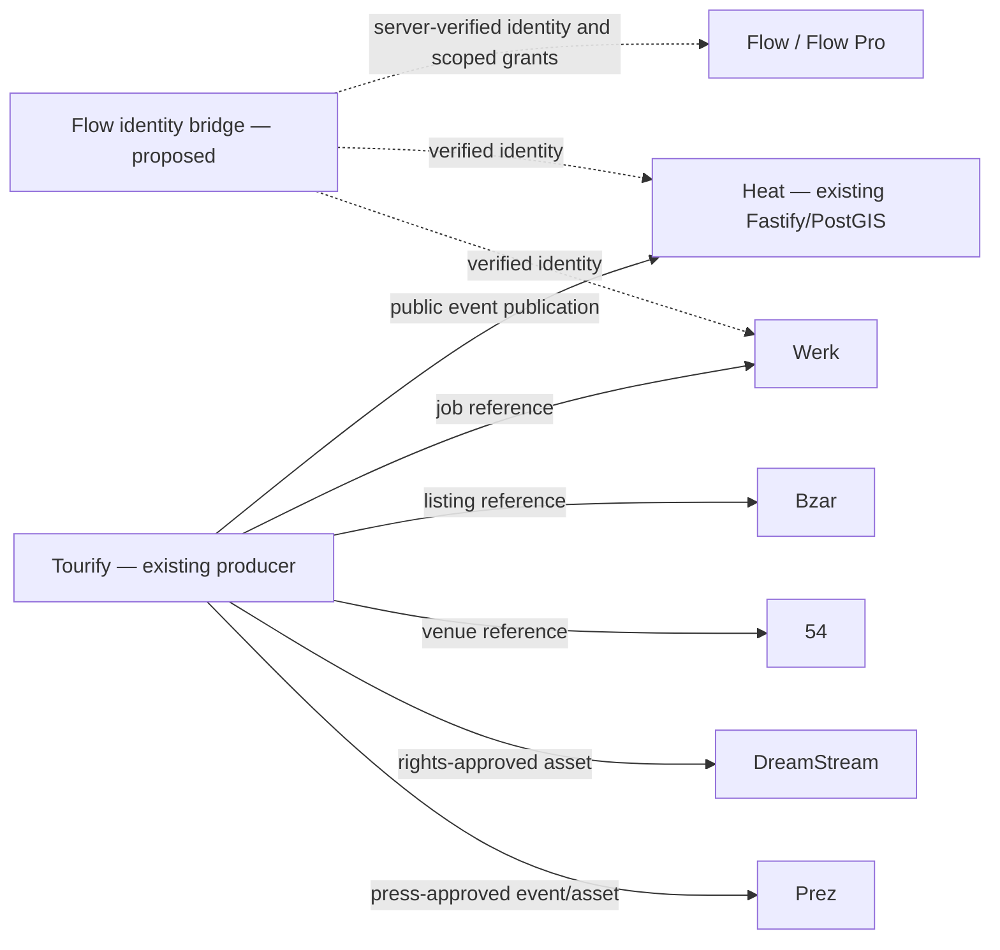

# Intended integration graph, not live endpoints

## Integration contract checklist (all consumers)
1. Verified producer and audience; never trust naked JSON identity claims.
2. Exact contract version checked; incompatible versions quarantined.
3. Only public/consented fields; deny unknown keys.
4. Monotonic per-aggregate revision; duplicates ignored; conflicts escalated; tombstones applied.
5. Transactional outbox at source; delivery may be retried; consumer idempotent.
6. Explicit owner and jurisdiction for each record, storage, API and worker.
7. No cross-product SQL superuser, shared `service_role`, or unprotected ingestion.
8. Dedicated integration tests and rollback. Track lag and dead-letter count.
9. New roles do not silently grant existing Tourify permissions.
10. Change request uses two product signoffs + identity/security review.

## First implementation pilot: Tourify → Heat public event projection
Draft producer boundary: Tourify events with explicit public publish permission, sanitization and monotonically increasing revision. Draft consumer boundary: Heat accepts only verified signed service calls, validates this schema, stores projection keyed by source + event UUID, handles unpublish via tombstone. API and transport designs remain pending security/owner approval.

## Product expansion
Werk: job reference and role taxonomy, application status scoped to employer/worker; no access to personnel records through public projection.
Bzar: listing reference and paid fulfillment events, one financial ledger authority; refunds/disputes not mirrored generically.
DreamStream: content rights and asset derivative states, revocation propagation.
54: venue reference availability vs private booking/resource calendar must be separate contracts.
Prez: embargoed materials remain private; never route them into public event projection.
Flow / Flow Pro: only consume published info and scoped product capabilities; don't mutate private aggregates through a generic feed.
